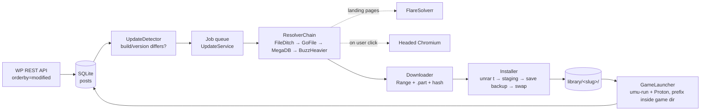

# Architecture

Single process: an Avalonia app that owns a tray icon, a main window (hidden on close), and background tasks. All logic lives in `SteamRip.Core` (no Avalonia dependency) so it can be unit-tested and driven from a console harness.

## Pipeline

## Components (`src/SteamRip.Core`)

| Area | Types | Responsibility |
| --- | --- | --- |
| `Catalog` | `CatalogClient`, `CatalogParser`, `TitleParser`, `HosterDetector`, `CatalogPost`, `Mirror`, `Hoster` | Page through the REST API (100/page, 1.5 s between pages, 429/502/503 back-off ≤6 attempts honouring `Retry-After`), parse title version, `acf.tagmetafield` build, `steam_app_id`, Game Size, `shortc-button` mirrors. `GetModifiedSinceAsync(since)` for incremental checks. |
| `Solver` | `FlareSolverrClient`, `Session`, `BrowserSolver` | `request.get`, `sessions.create/destroy`, fork `actions` (`eval`, `wait_for`); health check `GET /`; Playwright headed Chromium fallback with challenge-title polling. |
| `Hosters` | `IHostResolver`, `FileDitchResolver`, `GoFileResolver`, `MegaDbResolver`, `BuzzHeavierResolver`, `ResolverChain`, `HostPages`, `ResolvedDownload` | Share URL → direct URL + headers + optional hashes/expiry. See `hosters.md`. |
| `Downloads` | `Downloader`, `DownloadProgress`, `DownloadException` | Ranged resume into `<file>.part`, 416 = complete, 302/401/403/HTML body → `retryResolve`, SHA-256/MD5 verify, 30 s debug progress lines. |
| `Install` | `ArchiveTool`, `SaveLocator`, `Installer`, `InstallOptions`, `InstallResult` | See "Install flow". |
| `Launch` | `ExeFinder`, `ProtonLocator`, `ProtonDownloader`, `GameLauncher`, `LaunchSpec`, `LaunchCommand`, `RunningGame`, `LaunchOptions`, `HostCapabilities` | See "Launch flow" and "Launch tweaks". |
| `Updates` | `UpdateService`, `UpdateDetector`, `Job`, `JobStage`, `ManualSolve` | Scheduler, queue, play; the only place that stitches the others together. |
| `Data` | `Database`, `Settings`, `InstalledGame`, `InstallState` | SQLite with hand-written migrations; JSON settings. |
| `Platform` | `ISecretStore` (+ `SecretToolStore`, `DpapiFileStore`, `FileSecretStore`), `Notifier`, `Autostart`, `Shortcuts` | OS shims, Linux + Windows. |
| `Logging` | `FileLoggerProvider` | Daily file, 7-day prune, background writer, `LineWritten` for the UI tail, runtime `MinimumLevel`. |

## App (`src/SteamRip.App`)

- `Program.cs` — single-instance mutex `Global\steamrip-desktop-single-instance` (the `Global\` prefix makes it per user instead of per Unix session; desktop launches via systemd --user each get their own session); a second launch writes `<config>/.show` (or `<config>/.play` holding a post id when started with `--play <id>`), which the running instance watches and reacts to by showing the window.
- `App.axaml(.cs)` — palette resources, `TrayIcon` + `NativeMenu` (Open library / Check for updates now / Pause auto-updates / Quit), `ShutdownMode.OnExplicitShutdown`, hide-on-close, `--hidden`/`--show`, crash logging hooks. `AppServices.Build(args)` constructs the whole object graph by hand (no DI container) and logs tool discovery (unrar/7z/umu/wine/Proton builds) at startup.
- `Services/CoverCache.cs` — covers from `cdn.cloudflare.steamstatic.com/steam/apps/<appid>/library_600x900.jpg` (fallback `header.jpg`), no API key. Fetched on first read of an item's `Cover` property (i.e. when the card renders), 4 downloads in flight, disk cache `<config>/covers/<appid>.jpg`, decoded once at 140 px width and shared in memory. A miss is tried up to 3 times with short backoff, then remembered for this process only (the in-memory map); the next start tries again. Leftover `<appid>.missing` markers from older builds are deleted on sight. Posts without a Steam app id (~1.5 %) show the name's initial.
- ViewModels (CommunityToolkit.Mvvm): `MainViewModel` (nav, sync line, solver health every 30 s, counts, 15 s poll while games run), `LibraryViewModel`/`LibraryItem` (Play/Stop, Update, Forget/Delete; "Launch options" raises `OptionsRequested`, which `MainViewModel.Editing` shows in a side sheet over the window with exe/Proton/args/tweaks), `BrowseViewModel` (search box, sort dropdown `SortOption`, genre dropdown from `Db.GetCategories()` refreshed after each sync), `QueueViewModel` (cancel, solve in browser), `ActivityViewModel` (events + live log tail), `SettingsViewModel` (incl. launch defaults and the capability check), `LaunchOptionsEditor` (one `LaunchOptions` form used twice: in Settings it edits the defaults; on a game it shows the effective values, labels say the inherited default, and a toggle is only stored when it differs from that default so the game keeps following Settings otherwise; raises `Changed` after every edit).
- Views: `MainWindow.axaml` with DataTemplates per VM; `Styles.axaml`. Palette: ink `#141821`, amber `#F2B544`; mono font for paths/log.

## Data

### `settings.json` (`Data/Settings.cs`)

| Key | Default | Meaning |
| --- | --- | --- |
| `LibraryRoot` | `~/Games/SteamRIP` | Games live in `<LibraryRoot>/<slug>/` |
| `DownloadsRoot` | `~/Games/SteamRIP/.downloads` | Archives, `<slug>/<file>.rar(.part)`; independent of `LibraryRoot` |
| `DefaultProtonPath` | `GE-Proton` | A Proton directory, or a keyword: `GE-Proton` (umu's `PROTONPATH=GE-Proton`, downloaded and updated by umu) or `DW-Proton` (downloaded and updated by `ProtonDownloader`). `""` is read as `GE-Proton`. umu's own default (UMU-Proton, a Proton 10 build) is never used |
| `DefaultLaunch` | `LaunchOptions.AppDefaults` (gamemode on, fsync on, gamescope args `-f`, rest off) | Nested `LaunchOptions` object; the one deliberate exception to "flat settings" because the same record is stored per game |
| `FlareSolverrUrl` | `http://localhost:8191` | Health-checked; unreachable → GoFile/MegaDB still work |
| `CheckIntervalMinutes` | `60` | Incremental catalog check cadence |
| `AutoUpdatesPaused` | `false` | Tray toggle |
| `NotifyNewGames` | `false` | "New game posted" notifications (noisy) |
| `StartHidden` | `true` | Tray-only start unless `--show` |
| `Autostart` | `false` | XDG `.desktop` with `--hidden` / HKCU Run |
| `ShortcutMenu` | `true` | After each install, write an app-menu launcher for the game (`Shortcuts`, see below); removed on uninstall. Toggling applies to all installed games |
| `ShortcutDesktop` | `false` | Same, on the desktop |
| `DeleteArchiveAfterInstall` | `true` | |
| `KeepBackups` | `2` | Save backups kept per game |
| `VerboseLogging` | `false` | Debug level; `--verbose` flag does the same for one run |
| `HosterOrder` | `FileDitch, GoFile, MegaDb, BuzzHeavier` | Resolver order; names are `Hoster` enum values |

### SQLite (`Data/Database.cs`, WAL, `schema_migrations` table)

- `posts(id, slug, url, title, name, title_version, build, steam_app_id, modified_utc, published_utc, size_text, mirrors_json, seen_utc, size_bytes)` — the catalog cache; indexed on `modified_utc`, `name` and `size_bytes` (`CatalogParser.ParseSize` of the "Game Size" line, decimal units; migration 4 backfilled it).
- `categories(id, name, count)` and `post_categories(post_id, category_id)` — WordPress categories, which the site uses as genres (20 of them: Action, Indie, Adventure, …). Filled by `UpsertCategories` on every full sync (one `/wp/v2/categories` request) and by `UpsertPosts` from the post's `categories` ids; a post that arrives without ids never clears its rows. Migration 5 also deleted `catalog_complete` so the next sync was a full one and backfilled all ~5,000 posts (111 s here, no 429).
- `posts.popularity_rank` (migration 6) — position in the site's own `/top-games/` listing ("most viewed", 24 per page). `UpdateService.RefreshPopularityAsync` runs after a sync at most once per 24 h (`kv.top_games_utc`), reads the first 42 pages (~1,000 ranks, 65 s with the 1.5 s delay; only `class="post-item post-<id>"` is parsed) and `SetPopularity` rewrites the column, NULL beyond the top. The REST API has no popularity signal and neither Steam nor SteamSpy covers the catalog usably.
- `SearchPosts(text, PostSort, categoryId, limit)` builds one SQL statement: name `LIKE`, `EXISTS` on `post_categories`, `ORDER BY` from the `PostSort` enum (`modified_utc`, `popularity_rank ASC NULLS LAST`, `published_utc`, `name COLLATE NOCASE`, `size_bytes … NULLS LAST`). Sorting happens in SQL so the 150-row window follows the chosen key; the view models never sort.
- `installs(post_id → posts, slug, name, installed_version, install_path, installed_utc, auto_update, state, last_error, exe_rel, proton, launch_args, last_played_utc, playtime_sec, launch_json)` — the library. `state` is `InstallState` (`NotInstalled, Queued, Downloading, Installing, Installed, Failed, NeedsAttention`). v2 added the launch columns; v3 added `launch_json` (a `LaunchOptions` with only the overridden fields, NULL = inherit everything).
- `events(id, at_utc, post_id, kind, message)` — sync/update/play/error history shown in Activity.
- `kv(key, value)` — `catalog_complete` (set to `1` only after a full sync finished; a migration that needs a backfill deletes it; while unset, e.g. after 429s interrupted the first sync, the next sync is full again).

Migrations are appended to `Database.Migrations[]`; never edit an existing entry.

### Secrets

`SecretStore.Create(configDir)`: Linux uses `secret-tool` (Secret Service) with a 0600-file fallback; Windows uses a DPAPI-protected file. Currently nothing long-lived is stored (debrid is parked, `cf_clearance` is not persisted because FlareSolverr re-solves cheaply); the shim exists so a token can be added without redesign.

## Flows

### Catalog sync and update detection

1. Startup and every `CheckIntervalMinutes`: `SyncCatalogAsync(full: false)` pulls REST pages ordered by `modified desc` until it reaches posts not newer than the newest `modified_utc` already in `posts` (or all pages when `catalog_complete` is unset / `full` requested). Upserts into `posts`.
2. `CheckForUpdates()` compares each `installs` row with its post: `UpdateDetector.IsUpdate(installed, post)` normalises `VersionKey` (`acf` build if present, else title version; strips "Build ") and only flags a real change — `modified` alone is not enough.
3. Flagged games with `auto_update = 1` and updates not paused are enqueued; others show "Update available".

### Download

`DownloadWithRetryAsync`: if a non-`.part` archive already exists in `<downloads>/<slug>/` it is reused (saves a resolve). Otherwise `ResolverChain.ResolveAsync(mirrors)`; on `DownloadException(retryResolve)` the link is re-resolved, on network errors it waits 15 s; three attempts, then the job goes to `NeedsAttention` with the collected errors and one notification. A `PreResolved` download (from the manual browser) skips resolution on the first attempt.

### Install flow (`Installer.InstallAsync`)

1. `ArchiveTool.TestAsync` (`unrar t` / `7z t`) — the integrity check, since hoster hashes are unreliable.
2. Extract into `<library>/.staging/<slug>/`; collapse a single top-level directory (moving `_CommonRedist`-style siblings inside).
3. Save backup from the **old** install into `<library>/.backups/<slug>/<old-version>/`: in-folder save-like dirs (`Save*`, `Saves`, `SaveGames`, `Profiles`, `Saved`, `UserData`… skipping engine dirs like `Engine`, `Content`, `Binaries`, `drive_c`), and Goldberg/GSE dirs (`GSE Saves`, `Goldberg SteamEmu Saves/<steam_app_id>`) found inside the game's own prefix.
4. Preserve the Wine prefix: any directory under the old install that looks like a prefix (`drive_c` + `system.reg`) is **moved** into the new tree at the same relative path. In-folder save dirs are copied across too.
5. Swap: old folder → temp name, staging → `<library>/<slug>/`, delete old. Failure before the swap leaves the old install untouched.
6. Prune backups to `KeepBackups`. Optionally delete the archive.

`UpdateService.RunJobAsync` wraps this: if the game is running it waits for exit first; after install it keeps `exe_rel` if that file still exists, else re-runs `ExeFinder.Best`; Proton, args and playtime carry over.

### Game shortcuts (`Platform/Shortcuts`)

A shortcut is the app itself with `--play <postId>`, so it goes through `UpdateService.PlayAsync` like the Play button (same Proton, launch options, playtime). `Program.Main` handles it in both cases: first instance → `App` starts hidden (unless `--show`) and calls `PlayAsync`; already running → the new process writes `<config>/.play` and exits, the watcher in `App` picks it up. Failures ("already running", "not installed") become a desktop notification and a log line.

Linux writes `steamrip-game-<postId>.desktop` to `$XDG_DATA_HOME/applications` (menu) or the XDG desktop dir (`xdg-user-dir DESKTOP`, fallback `~/Desktop`), executable so KDE/GNOME trust it, `Icon=` the cached Steam cover `.jpg` when present else the app icon. Windows writes a `.lnk` via `WScript.Shell` in PowerShell to `Start Menu\Programs\SteamRIP\<name>.lnk` or the desktop, with the app's icon. Creation after install honours `ShortcutMenu`/`ShortcutDesktop`; the per-game ⋯ menu adds or removes either one at any time; uninstall removes both.

### Launch flow (`UpdateService.PlayAsync` → `GameLauncher`)

1. Exe: stored `exe_rel`, else `ExeFinder.Best(gameRoot, name)` (scores name-token match +10, squashed-name match +10, `*-Shipping.exe` +8, `Binaries` +3, root depth +2, >50 MB +3; penalises launchers and tiny files; skips redist/uninstaller/crash-handler/`steam_api`/anything under `prefix` or a `drive_c`). Saved back to the DB.
2. Proton: `ProtonLocator.Effective(per-game proton column ?? Settings.DefaultProtonPath)`; empty means `GE-Proton`. The `GE-Proton` keyword is passed straight through as `PROTONPATH` (umu resolves, downloads and updates it under `~/.local/share/Steam/compatibilitytools.d/`). `DW-Proton` goes through `ProtonDownloader.EnsureDwProtonAsync`: GitHub `dawn-winery/dwproton-mirror` latest release → `<tag>-x86_64.tar.xz` + `.sha512sum` → `Downloader` into `compatibilitytools.d/.downloads` → SHA-512 check → `tar -xJf` into a staging dir → move to `compatibilitytools.d/<tag>`; the resolved directory is what `PROTONPATH` gets. One release check per 6 h; offline it uses the newest installed `dwproton-*` and fails the launch with a `LaunchException` only if there is none. `ProtonLocator.ResolveInstalled` picks the newest installed dir for a keyword (numeric version order) so `HostCapabilities` can reason about it.
3. Options: `UpdateService.EffectiveLaunch(g)` = per-game `launch_json` over `Settings.DefaultLaunch` over `LaunchOptions.AppDefaults` (null and blank fields inherit).
4. `GameLauncher.Compose(spec, runner, exe, prefix, findTool, screen)` is a pure function that returns the command line, the environment and warnings. Linux: `[wrapper] [gamemoderun] [gamescope <args> [-W w -H h] [--hdr-enabled] [--mangoapp] --] umu-run "<exe>" <args>` with env `WINEPREFIX=<gameRoot>/prefix`, `GAMEID=umu-<steam_app_id>` (or `umu-default`), `STORE=none`, `PROTONPATH=<proton>` when set, plus whatever the options add (next section); working directory = exe directory. Fallback without umu: `wine`. Windows: run the exe directly; only the wrapper and the free-form environment apply.
5. Process stdout/stderr tail is logged at Trace; exit is logged (user Stop at Information, unexpected non-zero or <10 s runs at Warning with the output tail). `Exited(postId, played, code)` adds playtime; `last_played_utc` is set at launch.
6. `Stop`: `Process.Kill(entireProcessTree)` then `umu-run wineboot -k` in the same prefix.

The prefix lives inside the game folder on purpose: one directory per game to back up, move or delete, and the installer's prefix-preservation step is what makes updates safe.

### Launch tweaks (`LaunchOptions`, `HostCapabilities`)

What each option does in `Compose`:

| Option | Effect |
| --- | --- |
| `MangoHud` (+ `MangoHudConfig`) | `MANGOHUD=1` (+ `MANGOHUD_CONFIG`); under gamescope it becomes `--mangoapp` instead, so there is one overlay, not two |
| `GameMode` | `gamemoderun` wrapper |
| `Gamescope` (+ `GamescopeArgs`, default `-f`) | `gamescope <args> -- …`; when the args carry no `-W/-H`, the largest connected output's preferred mode (from `/sys/class/drm/*/modes`) is added, because gamescope otherwise defaults to 1280x720 |
| `Hdr` | With gamescope: `--hdr-enabled`. Without: `PROTON_ENABLE_WAYLAND=1` (plus a warning if Wayland was not already on). Nothing else: GE-Proton 11, DW-Proton and Proton-CachyOS detect HDR per output (DXVK/VKD3D-Proton query the Vulkan surface; the Wayland driver reads the compositor's colour management, gamescope its HDR feedback). Forcing `DXVK_HDR=1`/`PROTON_ENABLE_HDR=1` made Cyberpunk output PQ onto an output Wine considered SDR: grey blacks, dull colours. Those vars in the free-form environment set to `1` produce a warning; `PROTON_FORCE_HDR=1` is the documented way to force it, `DXVK_NO_HDR=1` to suppress it |
| `Wayland` | `PROTON_ENABLE_WAYLAND=1` |
| `Fsr` | `WINE_FULLSCREEN_FSR=1` |
| `Fsync` | `false` → `PROTON_NO_FSYNC=1` (esync is gone in Proton 10; NTSync is picked by wine from `/dev/ntsync`, so neither has a toggle) |
| `ProtonLog` | `PROTON_LOG=1` |
| `DllOverrides` | `WINEDLLOVERRIDES` |
| `Environment` | `KEY=VALUE` lines applied last, so they override anything above (e.g. `DXVK_ASYNC=1`, `VKD3D_CONFIG=dxr`, `ENABLE_HDR_WSI=1`) |
| `Wrapper` | Command prefixed to everything (`env FOO=1`, `strace -f`, …) |

Env vars a Proton build does not know are inert, so Compose does not consult the build; the probe below only feeds the UI warnings. A missing `gamescope`/`gamemoderun` is a Warning in the log and the launch proceeds without it.

Wine's Wayland driver treats an output as HDR only when the compositor's maximum luminance exceeds its SDR-white (reference) luminance. KDE reports SDR brightness and peak (with the user override) in `kscreen-doctor -o`; `ParseKScreen` keeps both as `DisplayInfo.SdrNits`/`PeakNits`, and `HdrWarning` says so when SDR white is at the peak (games then see SDR; fix is lowering SDR brightness or `PROTON_FORCE_HDR=1`). A Proton build whose script mentions `DXVK_HDR`/`PROTON_ENABLE_HDR` (`ProtonCapabilities.LegacyHdr`, Proton 10 era such as UMU-Proton) gets a "no HDR auto-detection" warning.

`HostCapabilities.Probe()` runs once at startup on a background thread (~70 ms here) and on "Re-check" in Settings; the result is logged line by line and shown under "Capability check". It reads: `XDG_SESSION_TYPE`/`XDG_CURRENT_DESKTOP`; per-display HDR state from the compositor (KDE `kscreen-doctor -o`, GNOME `gdbus … DisplayConfig.GetCurrentState` `color-mode`/`supported-color-modes`, Hyprland `hyprctl monitors -j`, sway `swaymsg -t get_outputs`), falling back to the EDID's CTA-861 HDR static metadata block for capability only; GPU vendor and driver from `vulkaninfo --summary` with an HDR-WSI verdict (Mesa ≥ 25.1 or NVIDIA ≥ 595.58 built in, else look for an `*hdr*` implicit layer); `gamescope` (and whether its `--help` has `--hdr-enabled`/`--mangoapp`), MangoHud layer, `gamemoderun`, `/dev/ntsync`; and for each Proton build the `PROTON_*` names its `proton` script mentions (CachyOS knows `PROTON_ENABLE_WAYLAND`, Valve's Experimental does not). `HdrWarning(effective, protonPath)` turns that into one sentence next to the HDR checkbox when the combination cannot work (X11, no HDR output, HDR off in the display settings, gamescope missing, or a non-Wayland Proton without gamescope). Only the KDE path has been verified on real hardware; the other parsers are fixture-tested against documented output.

## Logging

`FileLoggerProvider` writes `<config>/logs/steamrip-YYYYMMDD.log`, prunes after 7 days, flushes on `ProcessExit`. Format `HH:mm:ss.fff LVL [Category] message`. Information covers every stage transition; Debug adds HTTP status/headers, timings, resolver internals (signed URLs redacted); Trace carries child-process output. The Activity view tails `LineWritten` live. Switch at runtime through Settings → Verbose logging.

## Testing

`tests/SteamRip.Core.Tests` (xunit, 58 tests, no network): catalog/title parsing against `Fixtures/posts_page1.json`; `HostPages` against saved FileDitch (solved + interstitial), BuzzHeavier and MegaDB HTML; `Downloader` against an in-process `HttpListener` that serves ranges and injected failures; `Installer`/`SaveLocator` against temp directory trees (collapse, backups, prefix preservation, prune); `FileLoggerProvider`; `ExeFinder` and `ProtonLocator`. Live hoster and site behaviour is exercised through throwaway harnesses under `/tmp`, never in the suite.

## Publishing

`SteamRip.App.csproj`: `WinExe`, `AssemblyName=steamrip-desktop`, self-contained single-file, RIDs `linux-x64;win-x64`, assets (`tray.png`, `app.png`, `app.ico`) embedded. On Windows the archive tool is looked up in PATH, `tools/`, and the 7-Zip/WinRAR install dirs.
